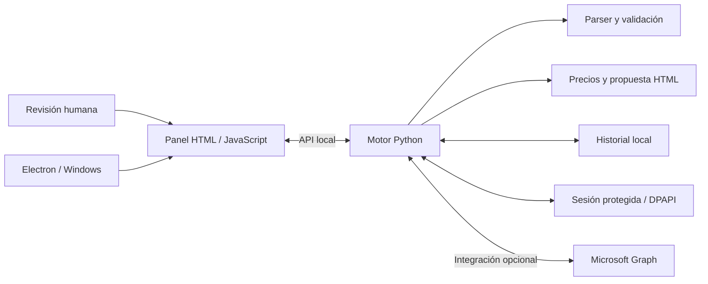

# Renewal Manager

[English](README.md) | [Português (Brasil)](README.pt-BR.md) | **Español (España)**

### Del aviso de renovación a una propuesta lista para el cliente.

Una aplicación de escritorio que reúne la lectura de correos, la revisión comercial, el cálculo de descuentos y el envío confirmado en un único flujo de trabajo. Desarrollada con **Python, Electron, JavaScript y Microsoft Graph**.

[](https://github.com/mwistro/renewal-manager/actions/workflows/tests.yml)

[Ver las pantallas](#showcase) · [Probar la demo](#probar-sin-credenciales) · [Arquitectura](#arquitectura) · [Ejecutar las pruebas](#desarrollo-y-pruebas)


> Edición de portafolio con identidad genérica. Las capturas muestran la interfaz real con cuentas, clientes, precios y registros ficticios. La conexión con Microsoft está simulada en las capturas; no se envía ningún correo. La interfaz está en español de España; la documentación está disponible en inglés, portugués de Brasil y español de España.

## El problema y la solución

Preparar una renovación implica interpretar el aviso recibido, identificar al cliente, separar el coste del precio de venta, aplicar el descuento y revisar el destinatario. Alternar entre la bandeja de entrada, los cálculos y la redacción del correo favorece los errores y la repetición de tareas.

Renewal Manager organiza estas etapas en una lista de revisión. La automatización extrae los datos y realiza su seguimiento; la decisión comercial y la confirmación final siguen en manos de quien utiliza la aplicación.

| Etapa | Qué hace la aplicación |
| --- | --- |
| Recibir | Identifica los avisos de los remitentes configurados y evita duplicados. |
| Revisar | Muestra el coste interno, el precio anterior, el precio de renovación y los datos del cliente. |
| Preparar | Calcula el descuento y genera una propuesta sin exponer el coste del proveedor. |
| Ajustar destinatario | Cambia la dirección de una propuesta pendiente conservando el contenido revisado. |
| Confirmar | Muestra el remitente, el destinatario, el asunto y el total antes de permitir el envío. |

## Showcase

### 01 · La revisión comercial en un solo lugar

El panel anterior reúne las renovaciones pendientes, los mensajes que requieren revisión y los envíos registrados. En el ejemplo, una propuesta de **1.800,00 €** recibe un **10 % de descuento**, con un total de **1.620,00 €**. El coste permanece en el panel interno.

### 02 · Lo que recibe el cliente

La vista previa se genera con el mismo código Python que prepara las propuestas. Muestra las licencias, la fecha de renovación, el descuento y el importe final, junto con los datos de contacto configurables del remitente.

<p align="center">
  
</p>

### 03 · Revisión antes del envío

La confirmación final permite comprobar los datos de la operación. Cambiar el descuento invalida la vista previa; cambiar solo el destinatario conserva el contenido revisado y exige una nueva confirmación con la dirección actualizada.

<p align="center">
  
</p>

### 04 · Cambia el destinatario sin rehacer la propuesta

La versión **1.1.0** incorpora las mejoras más recientes del flujo de revisión a la edición de portafolio. Tras revisar una propuesta, el usuario puede corregir el destinatario y pulsar **Revisar y enviar**. La confirmación muestra la nueva dirección y conserva el contenido del correo y el importe revisado.

<p align="center">
  
</p>

Las direcciones no válidas bloquean el envío sin descartar la vista previa. Si cambia el descuento, un aviso visible pide generar de nuevo la vista previa antes de enviar:


El backend emite un nuevo token de aprobación al cambiar el destinatario, revoca el anterior y conserva la caducidad original. Los destinatarios de prueba permanecen bloqueados. Un cambio durante la confirmación cierra el diálogo o impide abrirlo, evitando aprobar una dirección desactualizada sin advertirlo.

<details>
<summary><strong>Ver la pantalla de acceso y la demostración independiente</strong></summary>

**Acceso con Microsoft** — el panel conectado permite recuperar la sesión local protegida.


**Editor independiente** — permite explorar los precios, los descuentos y la exportación de borradores sin conectar ninguna cuenta.


</details>

Las capturas se pueden reproducir con `npm run showcase`. El script utiliza respuestas locales simuladas, bloquea las solicitudes externas y muestra la interfaz y la plantilla de correo del propio proyecto. No contiene imágenes ni datos de una organización real.

## Probar sin credenciales

Con Python instalado, ejecuta lo siguiente desde la raíz del proyecto:

```sh
python -m http.server 8080 --bind 127.0.0.1 --directory dist
```

Abre **http://127.0.0.1:8080** y pulsa **Cargar ejemplo ficticio**. Ajusta la base del precio, el descuento y los datos del remitente; revisa la vista previa y exporta un borrador `.eml`. También puedes abrir `dist/index.html` directamente; la copia al portapapeles depende de los permisos del navegador.

La demostración no se conecta a Outlook, no envía mensajes y conserva los datos únicamente en la memoria de la página. El archivo exportado se puede abrir en un cliente de correo compatible.

## Funcionalidades y decisiones técnicas

- Cálculo por licencia o por conjunto, con descuentos porcentuales o de importe fijo y valores monetarios en céntimos.
- Extracción de datos de correos HTML, con revisión cuando faltan campos o son ambiguos. El parser admite el formato de ejemplo de `tests/fixtures`; no es un parser universal para cualquier proveedor.
- Separación entre el coste interno y la propuesta que se presenta al cliente.
- Integración opcional con Microsoft Graph para leer correos, crear borradores y enviar tras la revisión y la confirmación.
- Corregir el destinatario conserva el correo revisado; cambiar el descuento exige otra vista previa. La confirmación queda vinculada al destinatario y a la revisión actuales de la propuesta.
- Historial local, eliminación de duplicados, recuperación tras interrupciones y gestión de envíos con resultado incierto, sin repetición automática.
- Sesión cifrada con Windows DPAPI, vinculada al usuario local.
- Aplicación Electron con aislamiento de contexto, sandbox, clave efímera entre procesos, notificaciones y funcionamiento en la bandeja del sistema.
- Controlador de actualizaciones probado de forma aislada; esta edición no tiene canal de distribución ni actualizaciones automáticas habilitadas.

## Estructura del proyecto

```text
dist/          Demostración estática y cálculo de propuestas
panel/         Interfaz del panel conectado
automation/    Parser, propuestas, Graph, persistencia y API local
desktop/       Integración Electron y configuración inicial
tests/         Pruebas automatizadas y correos sintéticos
scripts/       Preparación local, pruebas de interfaz y auditoría
```

El panel conectado se comunica con una API HTTP local en Python. El motor valida el origen y el destinatario, prepara la propuesta y exige una confirmación vinculada a la vista previa antes de enviar. La versión Electron utiliza el mismo motor como proceso hijo.

## Arquitectura



El editor de `dist/` es una demostración independiente: funciona en el navegador, calcula los valores localmente y exporta un archivo `.eml`. El panel de `panel/` muestra el flujo conectado, con persistencia y comunicación con el motor Python.

### Aspectos de ingeniería

- **Valores monetarios:** cálculo en céntimos; los descuentos en el motor Python utilizan `Decimal` y redondeo explícito.
- **Envíos inciertos:** una operación cuyo resultado no se ha confirmado no se repite automáticamente.
- **Separación de datos:** el coste y los campos internos del aviso no se incluyen en la propuesta enviada al cliente.
- **Límite entre procesos:** Electron restringe la navegación, aísla el renderer y autentica la comunicación con el motor mediante una clave efímera.
- **Verificación:** 67 pruebas Python y 23 pruebas JavaScript, además de comprobaciones en Edge del acceso, la demo offline, el cambio de destinatario y las modificaciones concurrentes, y una auditoría de los archivos preparados para su publicación.

## Desarrollo y pruebas

Instala Node.js 24 y Python 3.11+:

```sh
npm ci
npm test
npm run test:automation
```

Las pruebas de Graph utilizan respuestas simuladas. Las pruebas reales de DPAPI se ejecutan en Windows y se omiten en otros sistemas. Para las pruebas de interfaz, instala Microsoft Edge y ejecuta:

```sh
npm run test:ui
```

La prueba de la demostración también genera la captura del editor independiente. La prueba de destinatario utiliza respuestas simuladas de la API y no envía correos. Para reproducir las seis capturas del flujo conectado, con Edge instalado:

```sh
npm run showcase
```

`dist/` contiene código fuente estático versionado; la demostración no necesita un paso de compilación.

## Integración opcional con Outlook

La demostración no requiere configuración. Para desarrollar la integración real, utiliza tu propio registro de aplicación en Microsoft Entra y tu propia cuenta. Este proyecto no incluye ningún registro, credencial ni cuenta de una organización.

Para el panel del navegador, copia `automation/config.example.json` a `automation/config.local.json` y rellena `tenant_id`, `client_id`, `expected_mailbox`, `supplier_domains` y los datos de `company`. Revisa también la base del precio y el tratamiento de los impuestos. Ejecuta:

```sh
python -m automation iniciar
```

Para Electron, copia `desktop/public-config.json` a `desktop/config.local.json`, introduce tus identificadores de tenant y aplicación, el nombre de la empresa y los dominios de prueba, y ejecuta `npm run desktop`. La dirección del buzón se solicita al abrir la aplicación por primera vez. El flujo de escritorio exige identificadores de un tenant específico.

El cliente implementa la autenticación mediante código de dispositivo y solicita `User.Read`, `Mail.ReadWrite`, `offline_access` y, en el panel de envío, `Mail.Send`. La disponibilidad depende de la configuración y los permisos de tu propio tenant. La integración con sesión persistente está implementada para Windows; esta edición no incluye un instalador listo para usar.

## Datos y publicación

Los datos de contacto de ejemplo utilizan dominios reservados `example.com`. La configuración local, los correos reales, las sesiones, los registros, las dependencias y los artefactos de instalación se excluyen mediante `.gitignore`.

Antes de publicar cambios, revisa los archivos y audita exactamente el contenido preparado para el commit:

```sh
git add .
npm run audit
```

La auditoría comprueba rutas locales, archivos de sesión, patrones de credenciales y direcciones que no sean de ejemplo. Complementa la revisión manual, sin garantizar la detección de todos los datos sensibles.
