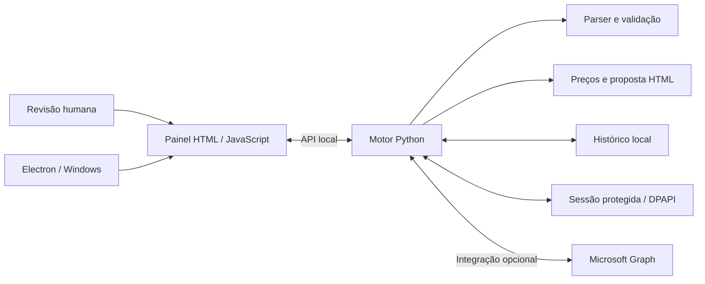

# Renewal Manager

### Do aviso de renovação à proposta pronta para o cliente.

Uma aplicação desktop que reúne leitura de emails, revisão comercial, cálculo de descontos e envio confirmado em um único fluxo. Desenvolvida com **Python, Electron, JavaScript e Microsoft Graph**.

[](https://github.com/mwistro/renewal-manager/actions/workflows/tests.yml)

[Ver as telas](#showcase) · [Experimentar a demo](#experimentar-sem-credenciais) · [Arquitetura](#arquitetura) · [Rodar os testes](#desenvolvimento-e-testes)


> Edição de portfólio com identidade genérica. As capturas são da interface real, com contas, clientes, preços e registros de demonstração. A conexão Microsoft é simulada nas capturas; nenhum email é enviado. Interface em espanhol e documentação em português.

## O problema e a solução

Preparar uma renovação envolve interpretar o aviso recebido, identificar o cliente, separar custo e preço de venda, aplicar o desconto e revisar o destinatário. Fazer isso entre caixa de entrada, cálculos e composição de email favorece erros e retrabalho.

O Renewal Manager organiza essas etapas em uma fila de revisão. A automação extrai e acompanha os dados; a decisão comercial e a confirmação final permanecem com quem usa o aplicativo.

| Etapa | O que o aplicativo faz |
| --- | --- |
| Receber | Identifica avisos dos remetentes configurados e evita duplicação. |
| Revisar | Exibe custo interno, preço anterior, preço de renovação e dados do cliente. |
| Preparar | Calcula o desconto e gera uma proposta sem expor o custo do fornecedor. |
| Confirmar | Mostra remetente, destinatário, assunto e total antes de permitir o envio. |

## Showcase

### 01 · Visão comercial em um só lugar

O painel acima reúne pendências, mensagens que exigem revisão e envios registrados. No exemplo, uma proposta de **1.800,00 €** recebe **10% de desconto**, chegando a **1.620,00 €**. O custo permanece no painel interno.

### 02 · O que chega ao cliente

Prévia gerada pelo mesmo código Python usado na preparação das propostas. Exibe licenças, vencimento, desconto e valor final, com o contato configurável do remetente.

<p align="center">
  
</p>

### 03 · Revisão antes do envio

A confirmação final permite conferir os dados da operação. A prévia perde a validade quando os campos são alterados, exigindo uma nova revisão.

<p align="center">
  
</p>

<details>
<summary><strong>Ver a tela de acesso e a demonstração independente</strong></summary>

**Acesso com Microsoft** — o painel conectado permite recuperar a sessão local protegida.


**Editor independente** — permite explorar preços, descontos e exportação de rascunho sem conectar uma conta.


</details>

As capturas podem ser reproduzidas com `npm run showcase`. O script usa respostas locais simuladas, bloqueia requisições externas e renderiza a interface e o template de email do próprio projeto. Não contém imagens nem dados de uma organização real.

## Experimentar sem credenciais

Com Python instalado, execute na raiz do projeto:

```sh
python -m http.server 8080 --bind 127.0.0.1 --directory dist
```

Abra **http://127.0.0.1:8080** e clique em **Cargar ejemplo ficticio**. Ajuste a base do preço, o desconto e os dados do remetente; acompanhe a prévia e exporte um rascunho `.eml`. Também é possível abrir `dist/index.html` diretamente; a cópia para a área de transferência depende das permissões do navegador.

A demonstração não conecta ao Outlook, não envia mensagens e mantém os dados apenas na memória da página. O arquivo exportado pode ser aberto em um cliente de email compatível.

## Funcionalidades e decisões técnicas

- Cálculo por licença ou por conjunto, com desconto percentual ou fixo e valores monetários em centavos.
- Extração de dados de emails HTML, com revisão quando campos estão ausentes ou ambíguos. O parser suporta o formato exemplificado em `tests/fixtures`; não é um parser universal de fornecedores.
- Separação entre custo interno e proposta apresentada ao cliente.
- Integração opcional com Microsoft Graph para leitura, rascunhos e envio após revisão e confirmação.
- Histórico local, deduplicação, recuperação após interrupções e tratamento de envios com resultado incerto, sem repetição automática.
- Sessão criptografada com Windows DPAPI, vinculada ao usuário local.
- Aplicação Electron com isolamento de contexto, sandbox, chave efêmera entre processos, notificações e execução na bandeja.
- Controlador de atualizações testado isoladamente; esta edição não possui canal de distribuição nem atualização automática habilitada.

## Organização

```text
dist/          Demonstração estática e cálculo de propostas
panel/         Interface do painel conectado
automation/    Parser, propostas, Graph, persistência e API local
desktop/       Integração Electron e configuração inicial
tests/         Testes automatizados e emails sintéticos
scripts/       Preparação local, testes de interface e auditoria
```

O painel conectado comunica-se com uma API HTTP local em Python. O motor valida a origem e o destinatário, prepara a proposta e exige uma confirmação associada à prévia antes de enviar. A versão Electron usa esse mesmo motor como processo filho.

## Arquitetura



O editor em `dist/` é uma demonstração independente: funciona no navegador, calcula os valores localmente e exporta um arquivo `.eml`. O painel em `panel/` demonstra o fluxo conectado, com persistência e comunicação com o motor Python.

### Pontos de engenharia

- **Valores monetários:** cálculo em centavos; no motor Python, descontos usam `Decimal` e arredondamento explícito.
- **Envios incertos:** uma operação sem confirmação de resultado não é repetida automaticamente.
- **Separação de dados:** custo e campos internos do aviso não entram na proposta enviada ao cliente.
- **Fronteira entre processos:** o Electron restringe navegação, isola o renderer e autentica a comunicação com o motor por uma chave efêmera.
- **Verificação:** 64 testes Python e 23 testes JavaScript, além de verificações de interface no Edge e auditoria dos arquivos preparados para publicação.

## Desenvolvimento e testes

Instale Node.js 24 e Python 3.11+:

```sh
npm ci
npm test
npm run test:automation
```

Os testes de Graph usam respostas simuladas. Os testes reais de DPAPI rodam no Windows; em outros sistemas, esses testes são ignorados. Para os testes de interface, instale Microsoft Edge e execute:

```sh
npm run test:ui
```

O teste da demonstração também gera a imagem do editor independente. Para reproduzir as outras quatro capturas, com Edge instalado:

```sh
npm run showcase
```

`dist/` contém código-fonte estático versionado; não há etapa de build para a demonstração.

## Integração opcional com Outlook

A demonstração não exige nenhuma configuração. Para desenvolver a integração real, use seu próprio registro de aplicação no Microsoft Entra e sua própria conta. Nenhum registro, credencial ou conta de organização acompanha este projeto.

Para o painel no navegador, copie `automation/config.example.json` para `automation/config.local.json` e preencha `tenant_id`, `client_id`, `expected_mailbox`, `supplier_domains` e os dados de `company`. Revise também a base do preço e o tratamento dos impostos. Execute:

```sh
python -m automation iniciar
```

Para Electron, copie `desktop/public-config.json` para `desktop/config.local.json`, informe seus identificadores de tenant e aplicação, o nome da empresa e os domínios de teste, e execute `npm run desktop`. O endereço do buzão é solicitado na primeira abertura. O fluxo de desktop exige identificadores de um tenant específico.

O cliente implementa autenticação por código de dispositivo e solicita `User.Read`, `Mail.ReadWrite`, `offline_access` e, no painel de envio, `Mail.Send`. A disponibilidade depende da configuração e das permissões do seu próprio tenant. A integração com sessão persistente foi implementada para Windows; não há instalador pronto nesta edição.

## Dados e publicação

Os exemplos de contato usam domínios reservados `example.com`. Configurações locais, emails reais, sessões, logs, dependências e artefatos de instalação são excluídos pelo `.gitignore`.

Antes de publicar alterações, revise os arquivos e audite exatamente o conteúdo preparado para commit:

```sh
git add .
npm run audit
```

A auditoria verifica caminhos locais, arquivos de sessão, padrões de credenciais e endereços não fictícios. Ela complementa a revisão manual, sem garantir a detecção de todo dado sensível.
