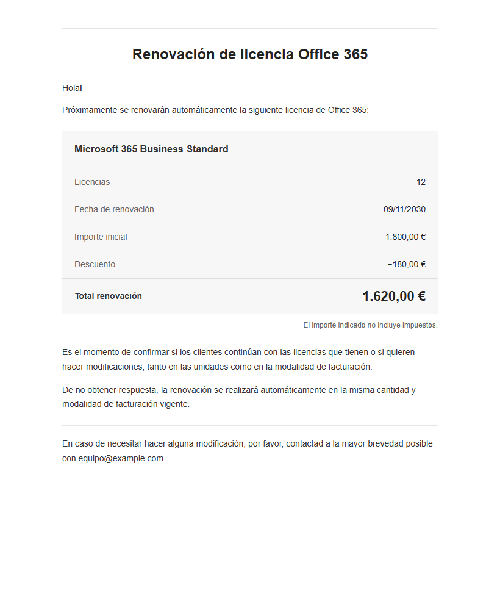
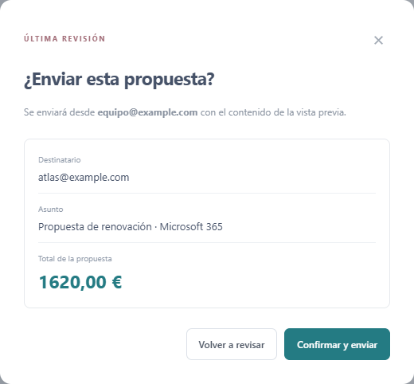
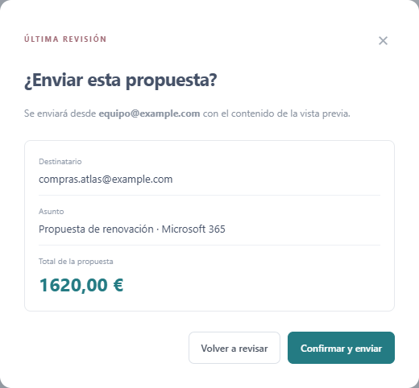
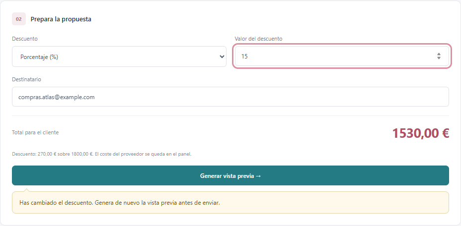
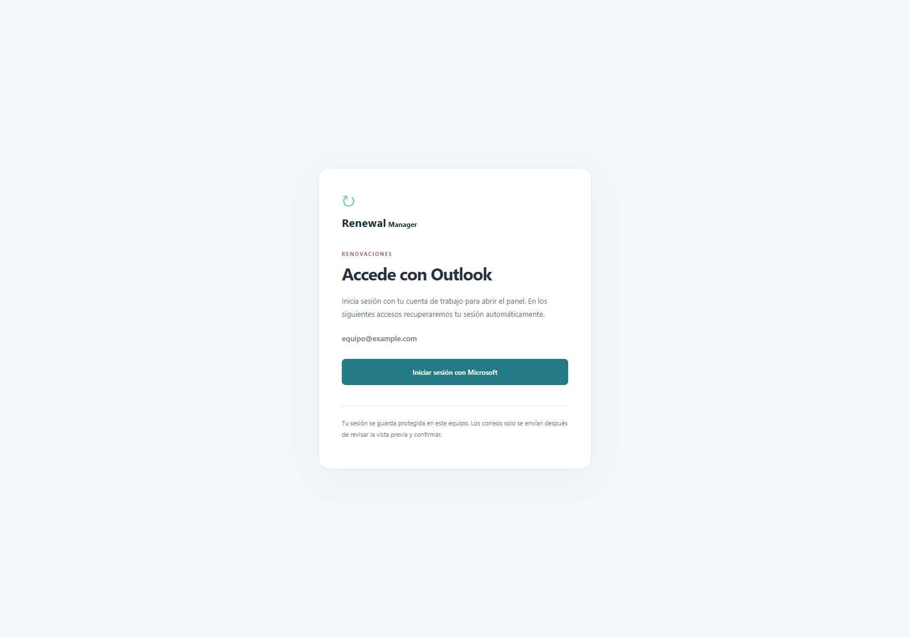
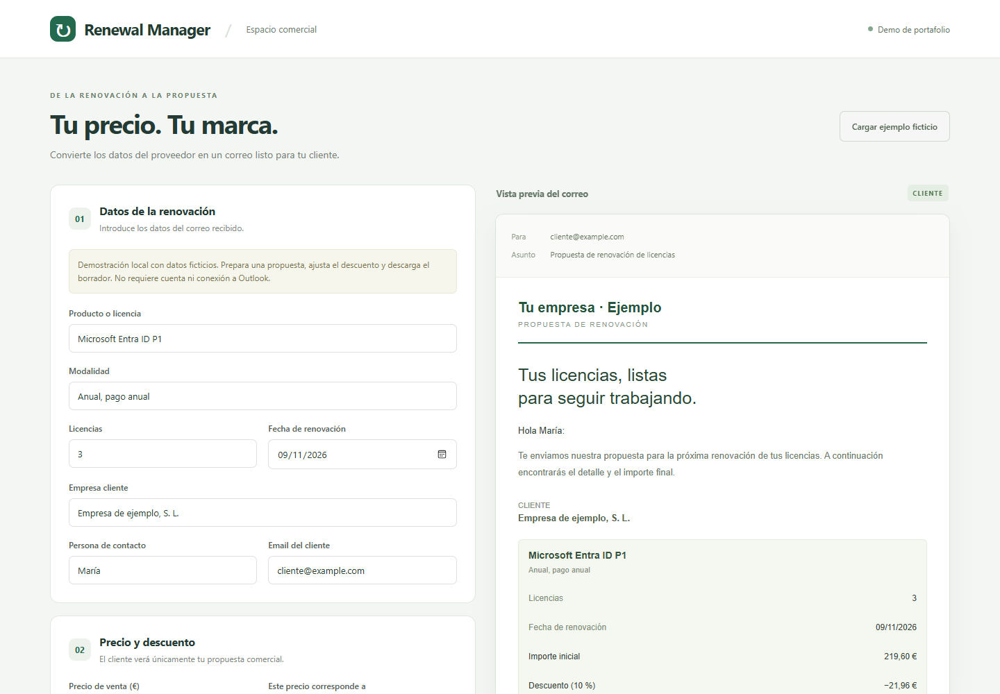
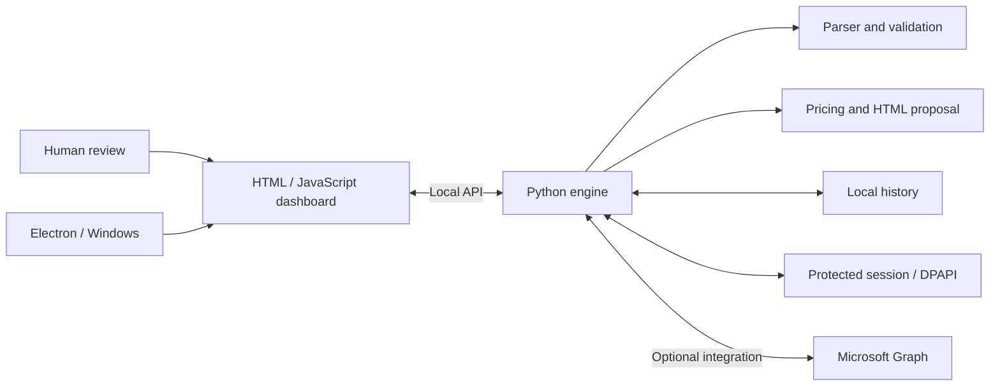

# Renewal Manager

**English** | [Português (Brasil)](README.pt-BR.md) | [Español (España)](README.es-ES.md)

### From a renewal notice to a proposal ready for your customer.

A desktop application that brings email reading, commercial review, discount calculations and confirmed sending into a single workflow. Built with **Python, Electron, JavaScript and Microsoft Graph**.

[](https://github.com/mwistro/renewal-manager/actions/workflows/tests.yml)

[Explore the screens](#showcase) · [Try the demo](#try-it-without-credentials) · [Architecture](#architecture) · [Run the tests](#development-and-testing)


> Portfolio edition with generic branding. Screenshots show the actual interface with fictional accounts, customers, prices and records. The Microsoft connection is simulated in the screenshots; no email is sent. The interface is in Spanish (Spain); documentation is available in English, Portuguese (Brazil) and Spanish (Spain).

## The problem and the solution

Preparing a renewal involves interpreting the incoming notice, identifying the customer, separating cost from selling price, applying a discount and checking the recipient. Switching between an inbox, calculations and email composition creates opportunities for mistakes and rework.

Renewal Manager organizes these steps into a review queue. Automation extracts and tracks the data; commercial decisions and final confirmation remain with the person using the application.

| Step | What the application does |
| --- | --- |
| Receive | Identifies notices from configured senders and prevents duplicates. |
| Review | Displays internal cost, previous price, renewal price and customer details. |
| Prepare | Calculates the discount and generates a proposal without exposing supplier costs. |
| Adjust the recipient | Changes the destination of a pending proposal while preserving its reviewed content. |
| Confirm | Shows the sender, recipient, subject and total before allowing the message to be sent. |

## Showcase

### 01 · Commercial review in one place

The dashboard above brings together pending renewals, messages requiring review and recorded sends. In this example, a **€1,800.00** proposal receives a **10% discount**, bringing the total to **€1,620.00**. Cost information stays in the internal dashboard.

### 02 · What the customer receives

The preview is generated by the same Python code used to prepare proposals. It shows licenses, the renewal date, the discount and the final amount, along with the sender's configurable contact details.

<p align="center">
  
</p>

### 03 · Review before sending

The final confirmation lets the user check the operation's details. Changing a discount invalidates the preview; changing only the recipient preserves the reviewed content and requires a fresh confirmation showing the new address.

<p align="center">
  
</p>

### 04 · Change the recipient without rebuilding the proposal

Version **1.1.0** brings the latest review-flow improvements into the portfolio edition. After reviewing a proposal, the user can correct its recipient and select **Revisar y enviar**. The confirmation shows the new address while the email content and total remain unchanged.

<p align="center">
  
</p>

Invalid addresses block sending without discarding the preview. If the discount changes, a visible reminder asks the user to regenerate the preview before sending:



The backend issues a new approval token for a recipient change, revokes the old token and preserves the original expiry. Test recipients stay locked. A change during confirmation closes or prevents the dialog so a stale recipient cannot be silently approved.

<details>
<summary><strong>View the sign-in screen and the standalone demo</strong></summary>

**Microsoft sign-in** — the connected dashboard can restore the protected local session.



**Standalone editor** — explore pricing, discounts and draft export without connecting an account.



</details>

Reproduce the screenshots with `npm run showcase`. The script uses simulated local responses, blocks external requests and renders the project's own interface and email template. It contains no images or data from a real organization.

## Try it without credentials

With Python installed, run this from the project root:

```sh
python -m http.server 8080 --bind 127.0.0.1 --directory dist
```

Open **http://127.0.0.1:8080** and click **Cargar ejemplo ficticio** (load fictional example). Adjust the pricing basis, discount and sender details; check the preview and export an `.eml` draft. You can also open `dist/index.html` directly; copying to the clipboard depends on browser permissions.

The demo does not connect to Outlook or send messages, and keeps data only in the page's memory. The exported file can be opened in a compatible email client.

## Features and technical decisions

- Per-license or bundle pricing, with percentage or fixed discounts and monetary values calculated in cents.
- Data extraction from HTML emails, with review required when fields are missing or ambiguous. The parser supports the format illustrated in `tests/fixtures`; it is not a universal supplier parser.
- Separation between internal costs and the proposal presented to the customer.
- Optional Microsoft Graph integration for reading emails, creating drafts and sending after review and confirmation.
- Recipient corrections preserve the reviewed email; discount changes require a new preview. Confirmation is bound to the current recipient and proposal revision.
- Local history, deduplication, recovery after interruptions and handling of uncertain send outcomes without automatic retries.
- Session encryption using Windows DPAPI, tied to the local user.
- Electron application with context isolation, sandboxing, an ephemeral key between processes, notifications and system tray operation.
- An update controller tested in isolation; this edition has no distribution channel or automatic updates enabled.

## Project structure

```text
dist/          Static demo and proposal calculations
panel/         Connected dashboard interface
automation/    Parser, proposals, Graph, persistence and local API
desktop/       Electron integration and initial setup
tests/         Automated tests and synthetic emails
scripts/       Local preparation, UI tests and auditing
```

The connected dashboard communicates with a local HTTP API in Python. The engine validates the source and recipient, prepares the proposal and requires confirmation tied to the preview before sending. The Electron version uses the same engine as a child process.

## Architecture



The editor in `dist/` is a standalone demo: it runs in the browser, calculates values locally and exports an `.eml` file. The dashboard in `panel/` demonstrates the connected workflow, with persistence and communication with the Python engine.

### Engineering highlights

- **Monetary values:** calculations use cents; discounts in the Python engine use `Decimal` and explicit rounding.
- **Uncertain sends:** an operation whose outcome has not been confirmed is never automatically repeated.
- **Data separation:** costs and internal notice fields are excluded from the customer proposal.
- **Process boundary:** Electron restricts navigation, isolates the renderer and authenticates communication with the engine using an ephemeral key.
- **Verification:** 67 Python tests and 23 JavaScript tests, plus UI checks in Edge for sign-in, the offline demo, recipient changes and concurrent edits, and an audit of files staged for publication.

## Development and testing

Install Node.js 24 and Python 3.11+:

```sh
npm ci
npm test
npm run test:automation
```

Graph tests use simulated responses. Real DPAPI tests run on Windows and are skipped on other systems. For UI tests, install Microsoft Edge and run:

```sh
npm run test:ui
```

The demo test also generates the standalone editor screenshot. The recipient test uses simulated API responses and sends no email. To reproduce the six connected-workflow screenshots, with Edge installed:

```sh
npm run showcase
```

`dist/` contains versioned static source code; the demo does not require a build step.

## Optional Outlook integration

The demo requires no configuration. To develop the real integration, use your own Microsoft Entra application registration and account. No organization registration, credentials or account are included in this project.

For the browser dashboard, copy `automation/config.example.json` to `automation/config.local.json` and fill in `tenant_id`, `client_id`, `expected_mailbox`, `supplier_domains` and the `company` details. Also review the pricing basis and tax treatment. Run:

```sh
python -m automation iniciar
```

For Electron, copy `desktop/public-config.json` to `desktop/config.local.json`, enter your tenant and application identifiers, company name and test domains, then run `npm run desktop`. The mailbox address is requested on first launch. The desktop workflow requires identifiers for a specific tenant.

The client implements device code authentication and requests `User.Read`, `Mail.ReadWrite`, `offline_access` and, in the sending dashboard, `Mail.Send`. Availability depends on your own tenant's configuration and permissions. Persistent-session integration is implemented for Windows; this edition does not include a ready-made installer.

## Data and publication

Example contact details use reserved `example.com` domains. Local configuration, real emails, sessions, logs, dependencies and installation artifacts are excluded by `.gitignore`.

Before publishing changes, review the files and audit the exact content staged for commit:

```sh
git add .
npm run audit
```

The audit checks local paths, session files, credential patterns and non-example addresses. It complements manual review without guaranteeing that every piece of sensitive data will be detected.
